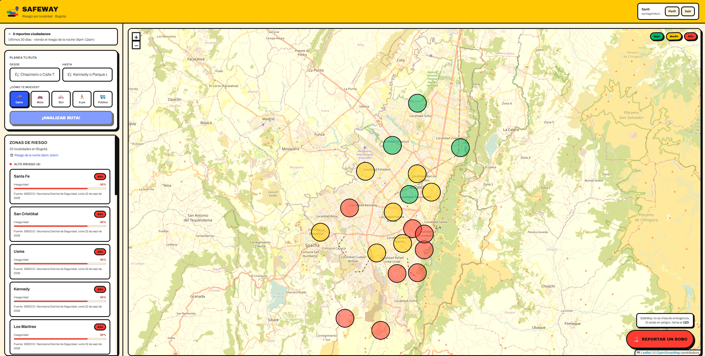
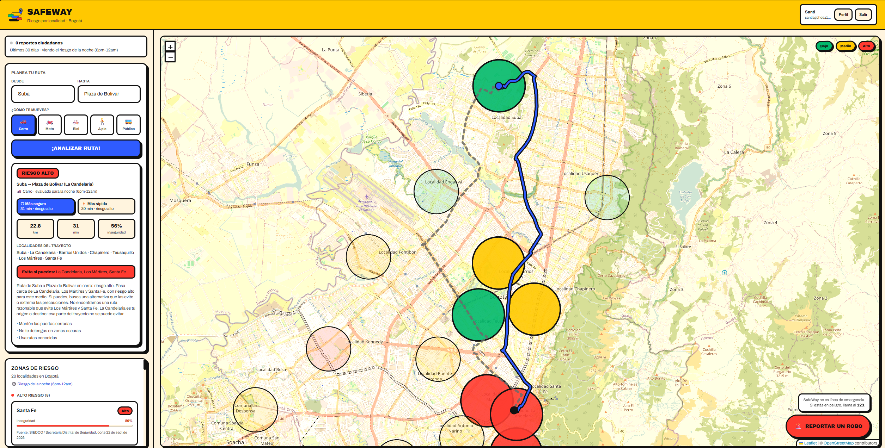
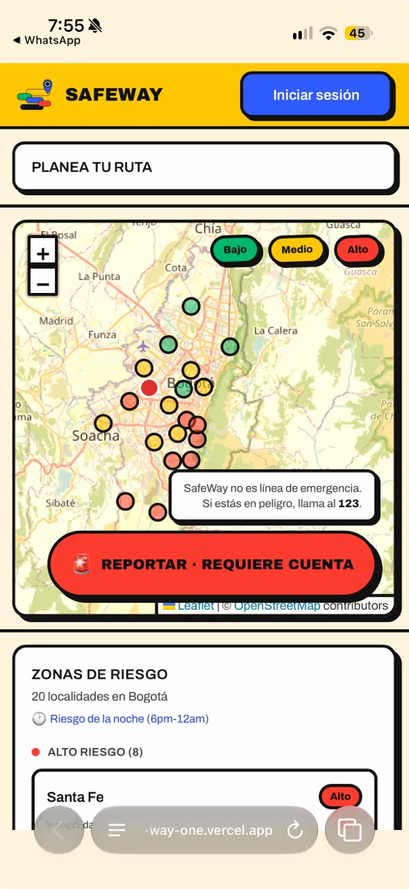
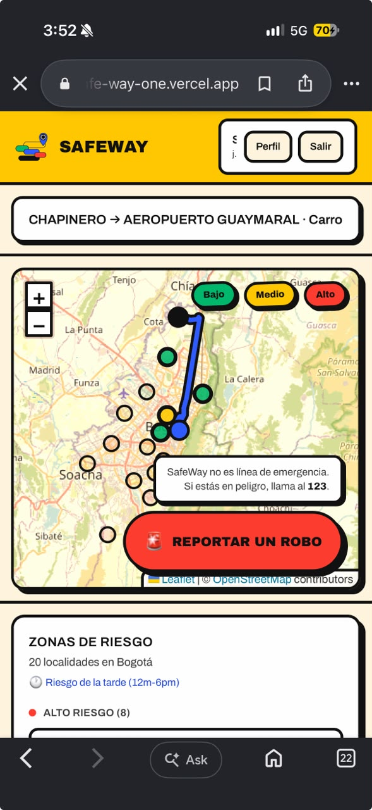
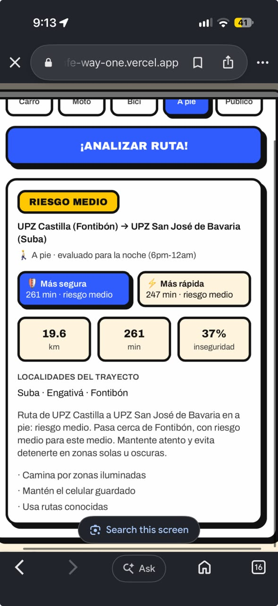
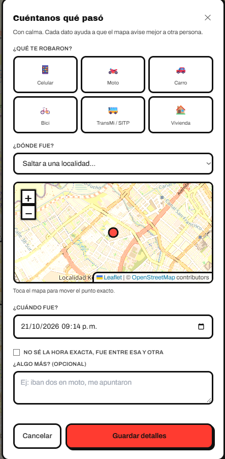
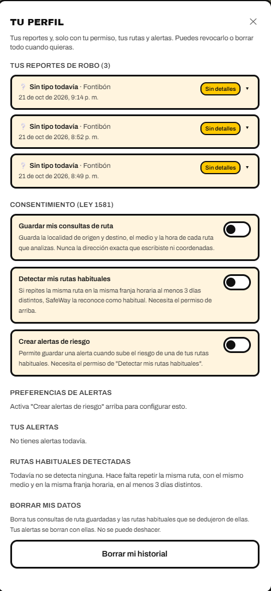

# SafeWay

Aplicación web que muestra el **nivel de riesgo por localidad de Bogotá** sobre un mapa y analiza
**qué tan riesgosa es una ruta** entre dos puntos según el medio de transporte (carro, moto,
bicicleta, a pie o transporte público).

Proyecto de aula de **Transformación Digital** — Universidad de Bogotá Jorge Tadeo Lozano, 2026-2.
Toma cifras oficiales de seguridad que hoy circulan en boletines y tablas y las convierte en una
decisión concreta: *¿por dónde voy?*

> SafeWay es una herramienta de apoyo informativo. **No es un canal de emergencia ni reemplaza
> la Línea 123.**

## Cómo se ve

Si no quieres abrir el enlace, así funciona SafeWay.

**1. El mapa de riesgo.** Cada círculo es una localidad de Bogotá, pintada en verde, amarillo o
rojo según los robos **del medio en que te mueves** y la franja horaria actual: en carro pesan
los robos de carro; en bus, el cosquilleo y el hurto de celular.



**2. Analizar una ruta.** Escribes origen y destino (una localidad o una dirección como
"Calle 72 # 7-30") y el medio de transporte. SafeWay busca la **ruta más segura**: compara las
alternativas y, si todas cruzan una zona roja, prueba desvíos para rodearla. Puedes escoger
entre 🛡 *Más segura* y ⚡ *Más rápida*; la otra se ve punteada en el mapa.



**3. En el celular.** Al analizar, se ve el mapa con la ruta y un resumen corto; el detalle
(riesgo, tiempo, zonas que evita y consejos para tu medio) queda a un toque.

<p align="center">
  
  &nbsp;
  
  &nbsp;
  
</p>

**4. Reportar un robo y ver tu historial.** El botón rojo envía el reporte con tu ubicación y la
hora en un toque; los detalles (qué te robaron, dónde, qué pasó) los completas después con calma.
En **Perfil** ves todos tus reportes y, solo si das permiso, tus rutas habituales y alertas.

<p align="center">
  
  &nbsp;
  
</p>

## Qué puede hacer

| Función | Detalle |
|---|---|
| Mapa de riesgo por medio | Carro, moto, bici, a pie o transporte público; cambia según la franja horaria (mañana, tarde, noche, madrugada) |
| Ruta más segura | Evita las localidades de riesgo alto si hay una alternativa razonable (hasta 1,6 veces el tiempo de la más rápida) y dice cuáles evita y cuánto tiempo cuesta |
| Direcciones reales | Acepta localidades o direcciones; muestra cómo entendió la dirección para que puedas corregirla |
| Consejos por medio | Los consejos cambian con el medio: no te dice "cierra las puertas" si vas a pie |
| Reporte ciudadano | Un toque con GPS; sin GPS, marcas el punto en el mapa. Máximo 5 reportes en 24 horas y 30 segundos para deshacer |
| Historial de reportes | En Perfil: cada reporte se despliega con su detalle y se puede completar o editar |
| Perfil proactivo | Con tu consentimiento (Ley 1581 de 2012) detecta tus rutas habituales y te avisa si sube su riesgo |
| Privacidad | Nunca guarda la dirección que escribes; los robos a vivienda se muestran difuminados (~300 m) |

**Límites que conviene saber:** el riesgo se mide por localidad, no por calle. Si tu origen o
destino está en zona roja, esa parte no se puede evitar. En transporte público el trazado va por
las vías principales con un tiempo estimado de bus; no sigue una ruta exacta de TransMilenio o
SITP. Sumapaz es la localidad rural del Distrito y queda unos 40 km al sur de la ciudad.

## Probarla en vivo

🔗 **[safe-way-one.vercel.app](https://safe-way-one.vercel.app)**

Funciona en computador y en celular, sin instalar nada. Ver el mapa y analizar rutas no pide
cuenta; reportar un robo y el perfil, sí.

El backend (Render, plan gratis) **se duerme a los 15 minutos sin uso**: la primera consulta
después de un rato puede tardar cerca de un minuto en responder mientras el servidor despierta.
Las siguientes son normales. Si el mapa parece colgado al abrir el enlace por primera vez en un
rato, dale un momento antes de recargar.

## Dónde corre

| Parte | Servicio | Guía |
|---|---|---|
| Frontend | Vercel | [docs/despliegue-frontend.md](docs/despliegue-frontend.md) |
| Backend (API) | Render, plan gratis (`render.yaml`) | [docs/despliegue-backend.md](docs/despliegue-backend.md) |
| Base de datos y cuentas | Supabase | [docs/setup-supabase.md](docs/setup-supabase.md) |

Un workflow programado (`.github/workflows/mantener-despierto.yml`) consulta la API cada 10
minutos en horario de uso para que Render no se duerma y Supabase no se pause por inactividad.

## Cómo está hecho

Tres capas desacopladas ([ADR-001](docs/arquitectura/adr/ADR-001-tres-capas.md)):

| Capa | Qué hace | Dónde |
|---|---|---|
| **Datos** | API con el riesgo de las 20 localidades desde Supabase, con un dataset de respaldo si Supabase falla | `Backend/src/services/`, `supabase/migrations/` |
| **Análisis** | Calcula la ruta, mide qué zonas de riesgo toca y da un nivel global bajo/medio/alto | `Backend/src/routes/`, `Backend/src/services/` |
| **Presentación** | Mapa interactivo (React + Leaflet) con burbujas de riesgo y panel de ruta | `Frontend/src/` |

Diagramas: [contexto](docs/arquitectura/contexto.md) · [contenedores](docs/arquitectura/contenedores.md) ·
Decisiones: [docs/arquitectura/adr/](docs/arquitectura/adr/) · Requisitos: [docs/requisitos.md](docs/requisitos.md) ·
API: [docs/api.md](docs/api.md) · Diseño y logo: [docs/diseno/](docs/diseno/README.md)

## Correrlo en local

Requisitos: **Node.js 20 o superior** y npm.

```bash
# 1. Backend (API en http://localhost:3001)
cd Backend
npm ci
cp .env.example .env      # opcional: sin .env funciona con el dataset de respaldo
npm run dev

# 2. Frontend (en otra terminal; web en http://localhost:5173)
cd Frontend
npm ci
cp .env.example .env
npm run dev
```

**Sin `.env` el backend arranca igual**: usa el dataset de respaldo de 20 localidades y lo indica
en cada respuesta (`meta.localitySource: "respaldo-local"`). Para usar la base de datos real y el
inicio de sesión, pide los valores al dueño del proyecto de Supabase (guía completa en
[docs/setup-supabase.md](docs/setup-supabase.md)):

| Archivo | Variable | Qué es | ¿Secreta? |
|---|---|---|---|
| `Backend/.env` | `SUPABASE_URL` | URL del proyecto de Supabase | No |
| `Backend/.env` | `SUPABASE_KEY` | Llave **publishable** (anon) | No |
| `Backend/.env` | `SUPABASE_SECRET_KEY` | Llave **secret**: se salta RLS. Solo para scripts de carga y verificación | **Sí** |
| `Backend/.env` | `CORS_ORIGINS` | Orígenes permitidos, separados por coma (por defecto `localhost:5173` y `4173`) | No |
| `Frontend/.env` | `VITE_API_URL` | URL del backend (por defecto `http://localhost:3001`) | No |
| `Frontend/.env` | `VITE_SUPABASE_URL` / `VITE_SUPABASE_ANON_KEY` | Los mismos URL y llave publishable (para el inicio de sesión) | No |

Los `.env` **nunca** se suben (están en `.gitignore`). La llave secreta no se comparte por chat.

## Pruebas y verificación

```bash
cd Backend && npm test            # criterios de aceptación de la capa de datos y análisis
cd Frontend && npm run lint && npm run build
node tools/verificar-capas.js     # que las tres capas sigan desacopladas
```

El CI (`.github/workflows/ci.yml`) corre todo esto en cada PR. Si está en rojo, no se fusiona.

## Estructura

```
Backend/            API Node.js + Express 5
  src/routes/       endpoints HTTP (validan y responden)
  src/services/     lógica y acceso a datos (Supabase, respaldo, riesgo)
  src/data/         dataset de respaldo de las 20 localidades
  scripts/          verificación de la configuración y de RLS
  test/             pruebas (node:test)
Frontend/           React 19 + Vite + react-leaflet
supabase/           configuración y migraciones versionadas de la base de datos
data-processing/    scripts de limpieza y carga de fuentes de datos
docs/               arquitectura, ADR, requisitos, contrato de la API, diseño y logo
tools/              verificaciones de arquitectura
```

## Cómo contribuir

Todo entra por pull request con el CI en verde y una revisión. Ver [CONTRIBUTING.md](CONTRIBUTING.md).

## Equipo

| Integrante | Rol |
|---|---|
| Sergio Daniel Aza Ocampo | Director del proyecto |
| Santiago Martínez Beltrán | Subdirector y QA |
| Julián Santiago Hernández Gonzales | Desarrollador web |
| Juan Camilo Pulido Vargas | Diseñador UX/UI |

## Fuentes y licencias

- Cifras de criminalidad: **Secretaría Distrital de Seguridad, Convivencia y Justicia** y
  **Policía Metropolitana de Bogotá (SIEDCO)**, como fuente oficial.
- Datos cartográficos y teselas: © [OpenStreetMap](https://www.openstreetmap.org/copyright)
  contributors (ODbL).
- Rutas: OSRM, servidores públicos de FOSSGIS (`routing.openstreetmap.de`, un perfil por medio:
  carro, bici y a pie) · geocodificación de direcciones: Nominatim (OpenStreetMap), con caché y
  límite de 1 solicitud por segundo.
- Código: [MIT](LICENSE), para fines académicos. React y Express (MIT), Leaflet (BSD-2-Clause).
